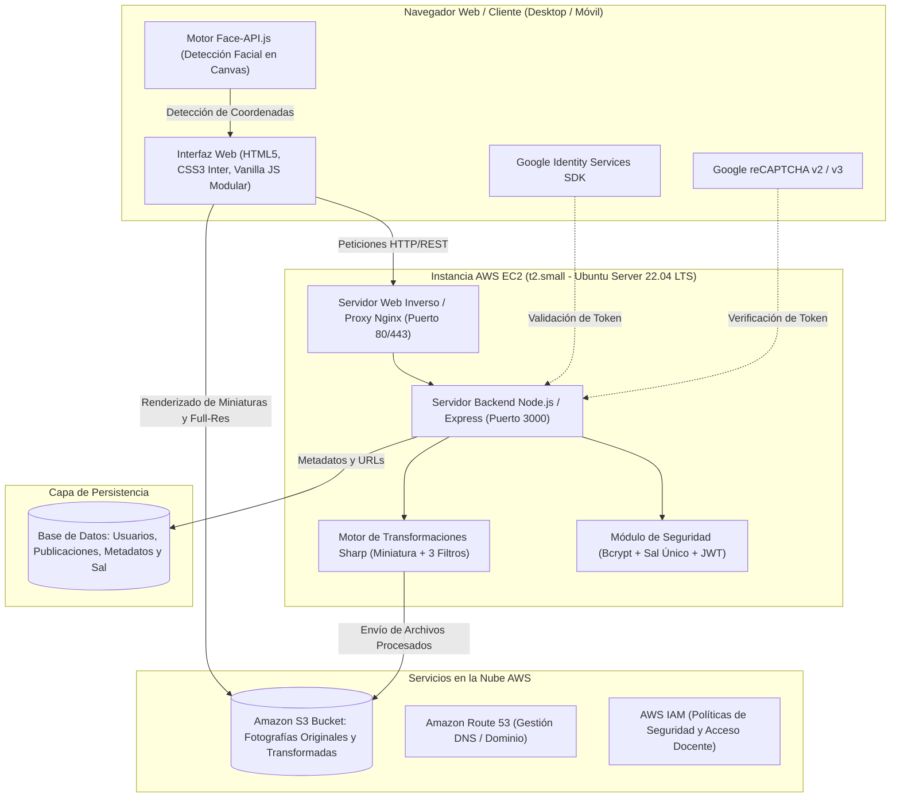
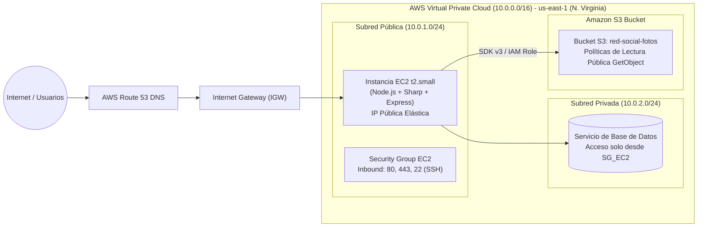

# 📐 MANUAL 1: ARQUITECTURA DE LA SOLUCIÓN, COMPONENTES Y CLOUD COMPUTING
**Curso:** Desarrollo Web  
**Catedrático:** MSc. Ing. Carlos Alejandro Arias  
**Universidad Mariano Gálvez de Guatemala**  
**Proyecto Final:** Red Social Fotográfica Tipo Instagram con Procesamiento Automático y Nube AWS

---

## 1. Resumen Ejecutivo
InstaRed es una plataforma social para almacenar, transformar y navegar fotografías en alta resolución y miniaturas tipo Instagram. La arquitectura está diseñada bajo principios de alta disponibilidad, desacoplamiento de componentes y almacenamiento escalable en la nube (AWS S3) para cumplir rigurosamente con los requerimientos de la cátedra:
- **No almacenar imágenes directamente en la base de datos:** Las imágenes se conservan en un bucket de **Amazon S3** (o almacenamiento desacoplado de archivos con fallback local) y la base de datos relacional/documental únicamente guarda metadatos, identificadores y URLs públicas.
- **Procesamiento automático:** Generación en tiempo real de una miniatura optimizada de 400x400 px y 3 transformaciones independientes (Blanco y Negro, Sepia Cálido, Escala Reducida 50% / Filtro Artístico) mediante el motor de procesamiento **Sharp**.
- **Reconocimiento Facial Inteligente:** Integración de **face-api.js** para detección automática de rostros y delimitación gráfica en tiempo real.
- **Autenticación Avanzada:** Inicio de sesión y registro mediante **Google Identity Services (Google Login API)** y validación anti-bots mediante **Google reCAPTCHA**.

---

## 2. Diagrama Distribuido de Componentes

---

## 3. Segmentación de Red y Diagrama Cloud Computing (AWS)

La arquitectura de red en AWS implementa segmentación mediante una **Virtual Private Cloud (VPC)** dividida en subredes públicas y privadas, protegidas por **Security Groups**:

### Reglas de Seguridad (Security Groups)
| Protocolo | Puerto | Origen | Propósito |
| :--- | :--- | :--- | :--- |
| **SSH** | `22` | IP del docente / Administrador | Conexión remota por terminal |
| **HTTP** | `80` | `0.0.0.0/0` | Acceso web de la red social |
| **HTTPS** | `443` | `0.0.0.0/0` | Tráfico seguro con certificado SSL |
| **MongoDB** | `27017` | `10.0.1.0/24` (Subred Interna) | Tráfico exclusivo para la aplicación |

---

## 4. Esquema de Datos Relacional y de Entidades

La base de datos relacional/documental almacena exclusivamente los metadatos y la ubicación (URLs) de los recursos fotográficos, garantizando que el peso de los binarios no degrade el rendimiento de la base de datos:

### Colección / Tabla: `usuarios`
| Campo | Tipo | Restricción | Descripción |
| :--- | :--- | :--- | :--- |
| `_id` | ObjectId / UUID | Primary Key | Identificador único del usuario |
| `nombre` | String | NOT NULL | Nombre y apellido |
| `username` | String | UNIQUE, INDEX | Nombre de usuario único (ej: `@alessandro`) |
| `correo` | String | UNIQUE, INDEX | Correo electrónico institucional o personal |
| `password` | String | HASH | Contraseña cifrada en formato hash seguro |
| `salt` | String | NOT NULL | **Sal criptográfico único generado por usuario** |
| `googleId` | String | NULLABLE | ID de cuenta de Google si usa Google Login API |
| `fotoPerfil` | String | URL / Path | URL de S3 o ruta relativa del avatar |
| `fotoPortada` | String | URL / Path | URL de S3 o ruta relativa de portada |
| `siguiendo` | Array / Relación | Foreign Keys | Lista de IDs de usuarios seguidos |
| `fechaRegistro`| Date | DEFAULT NOW | Fecha y hora de alta en la plataforma |

### Colección / Tabla: `publicaciones`
| Campo | Tipo | Restricción | Descripción |
| :--- | :--- | :--- | :--- |
| `_id` | ObjectId / UUID | Primary Key | Identificador único de la publicación |
| `usuario` | ObjectId / FK | NOT NULL, INDEX | Clave foránea al usuario autor |
| `contenido` | String | NOT NULL | Pie de foto o texto descriptivo |
| `imagen` | String (URL) | NOT NULL | **URL de la foto en resolución completa (S3)** |
| `miniatura` | String (URL) | NOT NULL | **URL de la miniatura 400x400 (Sharp)** |
| `transformaciones` | JSON / Objeto | NOT NULL | Contiene URLs de las 3 transformaciones: |
| ↳ `blancoYNegro` | String (URL) | - | Versión Grayscale generada por Sharp |
| ↳ `sepia` | String (URL) | - | Versión con tinte Sepia y modulación cálida |
| ↳ `escalaReducida` | String (URL) | - | Versión con escala 50% y sharpening |
| `deteccionesFaciales`| JSON / Objeto | - | Resultados de face-api.js (cantidad y coordenadas) |
| `likes` | Integer | DEFAULT 0 | Contador numérico de "Me gusta" |
| `likedBy` | Array de FKs | INDEX | Evita votos duplicados por usuario |
| `fecha` | Date | DEFAULT NOW | Timestamp de creación |

### Colección / Tabla: `comentarios`
| Campo | Tipo | Restricción | Descripción |
| :--- | :--- | :--- | :--- |
| `_id` | ObjectId / UUID | Primary Key | Identificador del comentario |
| `publicacion` | ObjectId / FK | NOT NULL, INDEX | Referencia a la publicación comentada |
| `usuario` | ObjectId / FK | NOT NULL | Referencia al autor del comentario |
| `comentario` | String | NOT NULL | Contenido textual de la respuesta |
| `fecha` | Date | DEFAULT NOW | Fecha de emisión |
